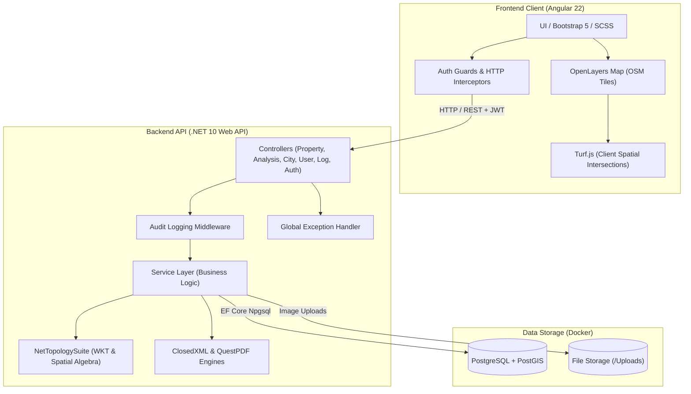
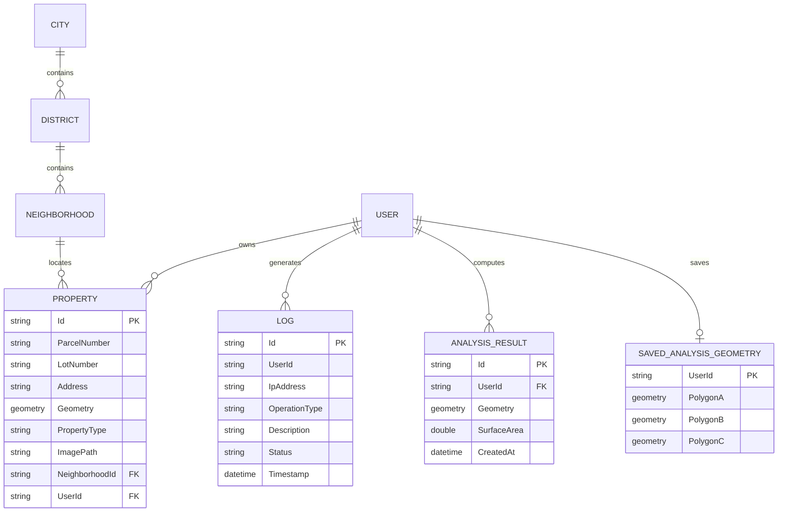

# 🌍 REMS - Real Estate Management System (Web GIS)

[](https://dotnet.microsoft.com/)
[](https://angular.dev/)
[](https://postgis.net/)
[](https://openlayers.org/)
[](https://turfjs.org/)
[](https://www.questpdf.com/)
[](https://github.com/ClosedXML/ClosedXML)

> **REMS (Real Estate Management System)** is a full-stack **Web Geographic Information System (Web GIS)** application designed for managing, analyzing, and reporting cadastral real estate assets and spatial geometries.
>
> 🎓 **Internship Project**: Developed during my internship at **[OdakGIS](https://www.odakgis.com.tr/)** (*Odak GIS ve Bilgi Teknolojileri*), focusing on enterprise GIS software design, spatial database modeling with PostGIS, geospatial algorithms with NetTopologySuite and Turf.js, and interactive mapping with OpenLayers.

---

## 📑 Table of Contents

- [Overview](#-overview)
- [Key Features](#-key-features)
  - [1. Cadastral & Property Management](#1-cadastral--property-management)
  - [2. Advanced Spatial Analysis (Area Analysis)](#2-advanced-spatial-analysis-area-analysis)
  - [3. Batch Import & Reporting (Excel / PDF)](#3-batch-import--reporting-excel--pdf)
  - [4. Authentication & Role-Based Access Control](#4-authentication--role-based-access-control)
  - [5. Audit Logging & System Telemetry](#5-audit-logging--system-telemetry)
- [Architecture & Tech Stack](#-architecture--tech-stack)
- [System Architecture Diagram](#-system-architecture-diagram)
- [Data Model & Entities](#-data-model--entities)
- [Getting Started](#-getting-started)
  - [Prerequisites](#prerequisites)
  - [1. Database Setup (Docker PostGIS)](#1-database-setup-docker-postgis)
  - [2. Backend Setup (.NET 10 API)](#2-backend-setup-net-10-api)
  - [3. Frontend Setup (Angular 22)](#3-frontend-setup-angular-22)
- [API Overview](#-api-overview)
- [Internship Highlights (OdakGIS)](#-internship-highlights-odakgis)
- [Author](#-author)

---

## 🧭 Overview

In municipal and private cadastral workflows, real estate assets require strict geometric tracking, administrative hierarchy (Province / District / Neighborhood), and spatial validations to prevent boundary overlaps and illegal zoning. 

**REMS** was developed to bridge modern Web GIS capabilities with robust enterprise backend engineering. It allows users and administrators to visualize properties on an interactive map, inspect spatial overlaps, draw custom geometries, compute spatial Boolean set operations (Intersections, Differences, Unions), calculate real surface areas, attach property photos, and generate official audit and property reports in PDF and Excel formats.

---

## ✨ Key Features

### 1. Cadastral & Property Management
- **Hierarchical Location Structure**: Cascading administrative selection: **City (İl) → District (İlçe) → Neighborhood (Mahalle)**.
- **Cadastral Attributes**: Tracking parcel numbers (*Parsel No*), lot/block numbers (*Ada No*), physical addresses, and property classifications.
- **Interactive Map Visualization**: Renders all properties as vector layers on an OpenStreetMap basemap using **OpenLayers**.
- **Interactive Boundary Drawing**: Draw and edit polygon geometry directly on the map in a dedicated modal when registering or updating properties.
- **Spatial Overlap Detection**: Uses **Turf.js** on the client to detect spatial collisions and highlight overlapping property parcels in red.
- **Image Attachments**: Upload, store, and preview on-site photos of parcels directly within property cards.

### 2. Advanced Spatial Analysis (Area Analysis)
- **Spatial Boolean Operations**: Powered by **NetTopologySuite** on the backend and **Turf.js** on the client:
  - **Intersection ($A \cap B$)**: Identifies and isolates overlapping geometric zones.
  - **Difference ($B \setminus A$)**: Computes relative geometric complement.
  - **Union ($A \cup B$ and $A \cup B \cup C$)**: Merges multiple spatial parcels into unified boundary sets.
- **Surface Area Calculation**: Computes accurate geometric area in square meters ($m^2$).
- **Geometry Persistence**: Users can draw multiple geometries ($A, B, C$), save them to the PostGIS database, and reload them anytime using the **Auto-Select** feature.
- **Coordinate Formatting**: Seamless conversions between **WKT (Well-Known Text)**, **GeoJSON**, and projected coordinate reference systems (**EPSG:3857**).

### 3. Batch Import & Reporting (Excel / PDF)
- **Bulk Excel Import**: Ingest dozens of cadastral properties at once via `.xlsx` spreadsheets with automated WKT coordinate validation and administrative hierarchy verification.
- **Excel Export**: Export filtered property records or audit logs into formatted spreadsheets via **ClosedXML**.
- **PDF Report Generation**: Export landscape A4 cadastral catalogs and audit logs via **QuestPDF**.

### 4. Authentication & Role-Based Access Control
- **JWT Bearer Authentication**: Secure stateless token issuance and verification.
- **Secure Password Hashing**: Passwords stored using HMAC-SHA512 with individual per-user salt hashes.
- **Role Permissions**:
  - `Admin`: Full system control, user management (CRUD), access to system-wide audit logs, ability to view and filter properties across all owners.
  - `User`: Creation, modification, and management of personal property assets and custom area analysis.
- **Angular Guards & Interceptors**: Automatic bearer token injection via HTTP interceptors and route guard protection.

### 5. Audit Logging & System Telemetry
- **Centralized Logging Middleware**: Intercepts every HTTP request in ASP.NET Core.
- **Full Traceability**: Records user identity, client IP address, HTTP method, target resource, execution timestamp, and status (*Succeed* / *Failed*).
- **Log Management Console**: Dedicated admin interface with pagination, granular filters, and instant report export.

---

## 🛠️ Architecture & Tech Stack

| Layer | Technologies | Description |
|---|---|---|
| **Frontend** | Angular 22, TypeScript, RxJS, Bootstrap 5, SCSS | Modern standalone component architecture |
| **Client GIS** | OpenLayers (`ol` 10.9), Turf.js (`@turf/turf` 7.3) | Map rendering, vector layers, client-side spatial intersections |
| **Backend API**| ASP.NET Core Web API (.NET 10.0), C# | RESTful API with Clean Architecture / Service-Repository pattern |
| **Spatial Engine** | NetTopologySuite (NTS), WKT Reader/Writer | Backend geometric operations, Boolean set algebra, and spatial queries |
| **ORM & Database**| Entity Framework Core 10, PostgreSQL, PostGIS | Spatial data storage with geometry types |
| **Reporting** | QuestPDF, ClosedXML | High-fidelity PDF generation and Excel workbook parsing/generation |
| **Security** | JWT (JSON Web Tokens), HMAC-SHA512 | Token authentication and role-based access control |
| **DevOps & Tools**| Docker, Docker Compose, Swagger / OpenAPI | Containerized spatial database and automated API documentation |

---

## 📐 System Architecture Diagram



---

## 🗄️ Data Model & Entities



---

## 🚀 Getting Started

### Prerequisites

Make sure you have the following installed on your machine:
- [Docker & Docker Compose](https://www.docker.com/)
- [.NET 10 SDK](https://dotnet.microsoft.com/)
- [Node.js (v20+ recommended)](https://nodejs.org/) & [Angular CLI](https://angular.dev/)

---

### 1. Database Setup (Docker PostGIS)

A ready-to-use Docker Compose configuration is provided with the official PostGIS image:

```bash
cd RemsProject
docker compose up -d
```

This starts a container with:
- **Image**: `postgis/postgis:latest`
- **Host Port**: `5433` (mapped to container `5432`)
- **Database**: `RemsDb`
- **Username**: `postgres`
- **Password**: `********` *(set your desired password in `docker-compose.yml` and `appsettings.json`)*

---

### 2. Backend Setup (.NET 10 API)

1. Navigate to the API directory:
   ```bash
   cd RemsProject/RemsAPI
   ```

2. Restore NuGet dependencies:
   ```bash
   dotnet restore
   ```

3. Apply Entity Framework Core database migrations:
   ```bash
   dotnet ef database update
   ```

4. Run the API:
   ```bash
   dotnet run
   ```
   The backend API will start on:
   - **HTTP**: `http://localhost:5044`
   - **Swagger UI**: `http://localhost:5044/swagger`

---

### 3. Frontend Setup (Angular 22)

1. Open a new terminal and navigate to the client directory:
   ```bash
   cd RemsProject/RemsClient
   ```

2. Install dependencies:
   ```bash
   npm install
   ```

3. Start the Angular development server:
   ```bash
   npm start
   ```

4. Open your browser and navigate to:
   ```text
   http://localhost:4200
   ```

---

## 📡 API Overview

| Area | Method | Endpoint | Description | Auth |
|---|---|---|---|---|
| **Auth** | `POST` | `/api/Auth/register` | Register a new user | Public |
| **Auth** | `POST` | `/api/Auth/login` | Authenticate user & return JWT | Public |
| **Properties** | `GET` | `/api/Property/filtered-properties` | Paginated property list with spatial filters | User / Admin |
| **Properties** | `POST` | `/api/Property` | Add a new cadastral property with geometry | User / Admin |
| **Properties** | `PUT` | `/api/Property` | Update existing property data/geometry | User / Admin |
| **Properties** | `DELETE`| `/api/Property/{id}` | Delete a property | User / Admin |
| **Properties** | `POST` | `/api/Property/{id}/image` | Upload property photo attachment | User / Admin |
| **Properties** | `GET` | `/api/Property/{id}/image` | Download/view property photo | User / Admin |
| **Properties** | `POST` | `/api/Property/import-excel` | Batch import properties via Excel (`.xlsx`) | User / Admin |
| **Area Analysis**| `POST` | `/api/AreaAnalysis/perform-analysis` | Perform spatial intersection, union, or difference | User |
| **Area Analysis**| `POST` | `/api/AreaAnalysis/save-geometries` | Save Polygons A, B, C for future analysis | User |
| **Area Analysis**| `GET` | `/api/AreaAnalysis/saved-geometries`| Retrieve saved analysis polygons | User |
| **Reports** | `POST` | `/api/Excel/properties` | Export filtered properties to Excel | User / Admin |
| **Reports** | `POST` | `/api/Pdf/properties` | Export filtered properties to PDF | User / Admin |
| **Reports** | `POST` | `/api/Excel/logs` | Export audit logs to Excel | Admin |
| **Reports** | `POST` | `/api/Pdf/logs` | Export audit logs to PDF | Admin |
| **Locations** | `GET` | `/api/Cities`, `/api/Districts`, `/api/Neighborhoods` | Administrative hierarchy lookups | Authenticated |
| **Users** | `GET`/`POST`/`PUT`/`DELETE` | `/api/User` | User management & role assignment | Admin |
| **Logs** | `GET` | `/api/Log/filtered-logs` | Filter and paginate audit logs | Admin |

---

## 🏢 Internship Highlights (OdakGIS)

This project was built during my software engineering internship at **OdakGIS** (*Odak GIS ve Bilgi Teknolojileri*), an engineering company specializing in Geographic Information Systems, urban management, and spatial technologies.

Key engineering competencies developed during the internship and showcased in this codebase:
- **Spatial Data Modeling**: Designing relational schemas with PostGIS geometry types and spatial indexing.
- **Computational Geometry**: Implementing geometric algorithms and Boolean algebra ($A \cap B$, $B \setminus A$, $A \cup B$) through NetTopologySuite and Turf.js.
- **Web GIS Cartography**: Handling vector layers, styling, custom interactions, projections (WGS 84 / Web Mercator EPSG:3857), and WKT/GeoJSON transformations with OpenLayers.
- **Enterprise Cadastral Domain**: Understanding real-world Turkish cadastre standards (*İl / İlçe / Mahalle*, *Ada / Parsel* numbering) and real estate asset management.
- **End-to-End Enterprise Architecture**: Integrating asynchronous .NET 10 Web APIs with an Angular single-page application, custom middleware for automated audit compliance, and containerized deployment with Docker.

---

## 👨‍💻 Author

**Emre Bozdoğan**
- GitHub: [@emrebozdogan](https://github.com/emrebozdogan)
- Project Repository: [emrebozdogan/Rems](https://github.com/emrebozdogan/Rems)
